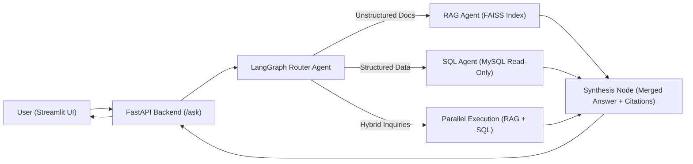

# 💼 MultiAgent Business Insights Copilot

[](https://www.python.org/downloads/)
[](https://fastapi.tiangolo.com)
[](https://streamlit.io)
[](https://github.com/langchain-ai/langgraph)
[](https://www.mysql.com/)
[](https://github.com/facebookresearch/faiss)

A production-grade, multi-agent AI assistant designed for business decision-makers. It answers complex inquiries by orchestrating **unstructured document retrieval (FAISS RAG)** and **structured enterprise database queries (MySQL Text-to-SQL)** with a **LangGraph** state machine.

> **Key Adaptations**:
> * **Forecasting Removed**: Cleaned out external forecasting APIs to focus purely on high-precision SQL and Document synthesis.
> * **MySQL 8.0 Integration**: Replaced PostgreSQL with MySQL, featuring dedicated read-only roles, AST query validation, and MySQL-dialect prompt engineering.

---

## 🏗️ System Architecture



### Component Summary
1. **LangGraph Router**: Classifies questions into `sql`, `rag`, or `hybrid` using a fast, cost-efficient model with structured JSON output.
2. **Text-to-MySQL Agent**: Generates safe MySQL `SELECT` queries based on dynamic schema inspection, executes on a read-only connection, and includes an automated 2-attempt self-correction loop on syntax errors.
3. **FAISS RAG Agent**: Indexes corporate strategy documents and policies using recursive chunking and semantic embeddings (SentenceTransformers / OpenAI), returning the top-$k$ relevant chunks with citations.
4. **Synthesis Node**: Fuses quantitative database rows with qualitative document context. Emphasizes strict grounding: numbers must come from MySQL, facts must have document citations, and the executed SQL is surfaced for auditability.
5. **FastAPI & Streamlit**: High-performance async backend and interactive UI with telemetry badges (latency, tokens, route) and query inspect expanders.

---

## 📁 Repository Structure

```
multiagent/
├── README.md                      # Comprehensive project guide
├── .env.example                   # Environment configuration template
├── .gitignore                     # Git ignore rules (secrets, venv, FAISS cache)
├── docker-compose.yml             # Orchestrates MySQL, FastAPI, and Streamlit
├── Dockerfile.backend             # Container spec for FastAPI service
├── Dockerfile.frontend            # Container spec for Streamlit interface
├── requirements.txt               # Locked dependencies
│
├── config/
│   └── settings.py                # Pydantic environment settings
│
├── data/
│   ├── documents/                 # Sample enterprise knowledge base
│   │   ├── q4_business_review.md
│   │   ├── return_policy.md
│   │   └── product_pricing_guide.md
│   └── mysql/
│       ├── 01_init_schema.sql     # Customers, Reps, Products, Orders, Items
│       └── 02_create_readonly_user.sql # Least-privilege MySQL role
│
├── src/
│   ├── agents/
│   │   ├── state.py               # LangGraph TypedDict state
│   │   ├── router.py              # Few-shot routing classifier
│   │   ├── sql_agent.py           # Text-to-MySQL agent with self-correction
│   │   ├── rag_agent.py           # Top-k chunk retriever
│   │   ├── synthesis_agent.py     # Final grounded synthesizer
│   │   └── graph.py               # StateGraph compiler and workflow runner
│   │
│   ├── database/
│   │   ├── mysql_client.py        # Safe read-only client & AST AST validator
│   │   └── schema_inspector.py    # Schema & sample rows generator
│   │
│   ├── rag/
│   │   ├── embeddings.py          # HuggingFace & OpenAI embedding service
│   │   ├── vector_store.py        # FAISS index with metadata mapping
│   │   └── ingest.py              # Recursive text splitter and builder
│   │
│   ├── api/
│   │   ├── app.py                 # FastAPI app with CORS & startup hooks
│   │   ├── routes.py              # Endpoints: /ask, /ask/stream, /health, /ingest
│   │   └── schemas.py             # Pydantic request & response models
│   │
│   └── ui/
│       └── app.py                 # Streamlit chat interface with SQL inspect
│
├── evaluation/
│   ├── test_dataset.json          # Benchmark dataset across SQL, RAG, Hybrid
│   └── evaluate.py                # Automated evaluation harness
│
└── scripts/
    ├── setup_db.py                # Bootstraps local MySQL database
    └── build_index.py             # Re-indexes documents into FAISS
```

---

## 🔒 Security & Safe SQL Execution

Allowing an LLM to generate SQL against an enterprise database presents severe injection and corruption risks. This project employs **three defense-in-depth layers**:

1. **Database Role Privileges**: The Text-to-SQL agent connects via `copilot_readonly`, a dedicated MySQL user granted **exclusively `SELECT` privileges**:
   ```sql
   CREATE USER 'copilot_readonly'@'%' IDENTIFIED BY 'readonly_pass';
   GRANT SELECT ON business_copilot.* TO 'copilot_readonly'@'%';
   ```
2. **Abstract Syntax Tree (AST) Inspection**: Every query is parsed with `sqlparse`. Any prohibited keyword (`DROP`, `DELETE`, `UPDATE`, `ALTER`, `TRUNCATE`, `GRANT`, etc.) or multiple statements immediately aborts execution before reaching MySQL.
3. **Execution Guardrails**:
   * Automatic injection of `LIMIT 50` if omitted to prevent memory exhaustion.
   * Session statement timeout (`SET SESSION max_execution_time=5000`) to prevent slow full-table scans.

---

## 🚀 Quickstart Guide

### Option 1: Run with Docker Compose (Recommended)

1. **Configure Environment**:
   ```bash
   cp .env.example .env
   # Edit .env and enter your OPENAI_API_KEY
   ```

2. **Start All Services**:
   ```bash
   docker compose up --build
   ```
   * **Streamlit UI**: `http://localhost:8501`
   * **FastAPI Docs (Swagger)**: `http://localhost:8000/docs`
   * **MySQL Database**: `localhost:3306` (pre-seeded automatically)

---

### Option 2: Local Python Development Setup

1. **Create Virtual Environment**:
   ```bash
   python -m venv .venv
   source .venv/bin/activate  # On Windows: .venv\Scripts\activate
   pip install -r requirements.txt
   ```

2. **Configure `.env`**:
   ```bash
   cp .env.example .env
   ```

3. **Initialize MySQL**:
   If you have a local MySQL server running:
   ```bash
   python scripts/setup_db.py
   ```
   *(Alternatively, run just MySQL via Docker: `docker compose up -d mysql`)*

4. **Build the FAISS Document Index**:
   ```bash
   python scripts/build_index.py
   ```

5. **Run FastAPI Backend**:
   ```bash
   uvicorn src.api.app:app --host 0.0.0.0 --port 8000 --reload
   ```

6. **Launch Streamlit Frontend**:
   ```bash
   streamlit run src/ui/app.py
   ```

---

## 📊 Evaluation & Benchmarking

The system includes a dedicated evaluation framework (`evaluation/evaluate.py`) that tests against a benchmark set of SQL, RAG, Hybrid, and Unanswerable questions:

```bash
python evaluation/evaluate.py
```

### Metrics Tracked:
* **Router Accuracy**: Classification match across SQL vs RAG vs Hybrid intent.
* **Retrieval Hit Rate @ k**: Percentage of queries where the ground-truth document chunk is in top-$k$.
* **SQL Execution Accuracy**: Rate of queries executing without syntax or schema errors.
* **Refusal Accuracy**: Rate at which unanswerable inquiries correctly return *"I don't know"* rather than hallucinating.
* **Latency & Token Telemetry**: Latency (seconds) and token burn per step.

---

## 🧪 Running Unit Tests

Run the PyTest test suite to verify AST query parsing, router fallbacks, and text splitters:

```bash
pytest tests/ -v
```

---

## 📤 Push Code to GitHub Repository

To push this project to your repository at `https://github.com/yashsidana/multiagent`:

```bash
cd "C:\Users\yashs.NIKHILSIDANA\.gemini\antigravity\scratch\multiagent"

# Initialize git repository
git init

# Add remote origin
git remote add origin https://github.com/yashsidana/multiagent.git

# Stage all files
git add .

# Initial commit
git commit -m "feat: initial commit of MultiAgent Business Insights Copilot (LangGraph, FAISS, MySQL, FastAPI, Streamlit)"

# Push to main branch
git branch -M main
git push -u origin main
```
